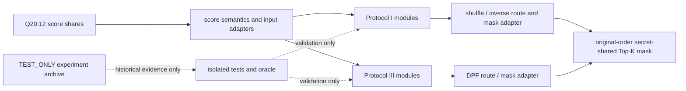

# 仓库架构与数据边界

更新日期：2026-11-20

本文说明 `main` 上活动实现、协议模块、测试材料和历史归档之间的关系。它描述代码组织，不构成安全证明，也不把未合并分支上的实验结果改写成主分支验收。

## 项目状态和统一接口

项目当前暂停归档。`VFSS/` 是唯一活动实现目录；`VFSS-baseline/` 是冻结基线。主分支已记录 M2、M3、M5 的工程状态。M6A、M6B、M7 尚未完成主分支验收。

统一语义由 `VFSS/include/moe_topk/score_semantics.h`、`topk_oracle.h` 和相关决策文档共同约束：输入为 signed Q20.12 score shares，按 score 降序、原始 index 升序稳定处理同分；结果为原始输入顺序下长度 `n` 的秘密共享 bit-mask，恰好 `K` 位为 1。oracle 和明文重构仅用于隔离测试，不是 secure runtime 的输入。

## 模块关系

图中表示仓库的模块边界与目标数据合同；每条协议路径的实现完成度、轮数、材料和安全结论必须以对应版本的实现及决策/验收文档为准。

## 代码分区

| 路径 | 责任 | 边界 |
| --- | --- | --- |
| `VFSS/include/moe_topk/` | Top-K 语义、协议接口、输入适配、比较、路由、输出与计量的头文件 | 唯一活动协议实现接口目录 |
| `VFSS/src/moe_topk/` | Protocol I、Protocol III 及必要适配/指标的实现 | 具体完成状态以主分支实现和阶段证据为准 |
| `VFSS/src/apps/` | 可执行程序入口 | 不代表每个入口都通过独立接收或正式性能门 |
| `VFSS/tests/moe_topk/`、`VFSS/tests/e2e/`、`VFSS/tests/bench/` | conformance、oracle differential、E2E 与 benchmark 入口 | 明文 oracle 和测试重构只留在隔离测试路径 |
| `VFSS/ext/` | VFSS 使用的 FSS、cryptoTools、bitpack 等依赖 | 不与项目参考工程混为一体 |
| `VFSS-baseline/` | 恢复和比较基线 | 冻结，不作为日常修改目录 |
| `docs/` | 语义、设计决策、阶段计划、来源和证据 | 代码行为不能反向充当论文定义 |
| `Papers/` | 本次归档的研究资料快照 | 15 个文件的 SHA-256 见 `docs/PAPERS.sha256`；来源/使用边界见 `docs/REFERENCE_MANIFEST.md` |
| `experiments/TEST_ONLY_BMW16_S2_SELECT_4R/` | BMW16-derived 四轮 Select 的明文 TEST_ONLY 候选、runner 与历史结果 | 不是论文精确复现、secure Protocol I 或 Top-K runtime |
| `experiments/TEST_ONLY_BMW16_S12/` | S12 共用 tape、C++ trace、逐案差分结果和 runner | 含 TEST_ONLY trace；不可作为协议随机性或生产材料使用 |
| `ADSMPC/`、`Agarwal_TopK/`、`CipherGPT/` | 历史本地参考工程 | 不追踪，不进入当前 runtime |

## 协议实现视图

### Protocol I

Protocol I 的实现模块围绕 `protocol_i_pipeline` 组织，包含 score 输入和 stable priority key、比较/`CmpAgg`、uCMP、share translation、secret-shared shuffle 与逆路由、party package 和 transport 等组件。各模块测试覆盖范围可从 `VFSS/tests/moe_topk/` 对应文件名及 `docs/IMPLEMENTATION_PLAN.md` 查到。

端到端主结果必须覆盖 raw-score 输入适配直到原序 mask；论文核心轮数、适配轮数和完整入口轮数要分别报告。隔离 worktree 中的 BMW16-derived Select 实验不会因为共享该语义或组件而继承 Protocol I 的安全结论。

### Protocol III

Protocol III 的实现模块包含 shared secure core/combine、field/DPF routing、raw-score pipeline、mask packaging 和 metrics。bit-mask 专用实例化与通用 ring-to-field 或 field-to-XOR 转换是不同边界；当前状态与轮数请以 README 的基线表、M5 接收记录及计划文档为准。

Protocol I 与 Protocol III 可共享语义和部分 primitives，不因此共享同一份安全证明。shuffle 路由、压缩 DPF 路由、输入表示及 mask 转换都必须按实际组合核验。

## 测试与安全边界

- 新原语/适配器的验证顺序是 conformance、oracle differential、独立进程 E2E；当前归档动作没有重跑这些测试。
- secure 路径不得重构 rank、比较位、selected index 或明文校验数据；这类重构只属于明确隔离的测试路径。
- `experiments/TEST_ONLY_*` 中的固定 tape、明文 key、输入映射和 trace 用来对齐有限测试，不是密码学随机数、party 私密视图证明或生产密钥材料。
- BMW16 S12 的历史 party-view 联合安全门为 `NO-GO / NOT_PROVED`，生产级 T 凭据与私有传输也未交付。相关证据归档不改变该结论。
- `VFSS-baseline/` 冻结；旧参考工程和压缩包都不属于本次主分支归档范围。

## 推荐阅读顺序

1. [项目总纲](../PROJECT.md)：范围、论文映射和统一语义。
2. [实施计划](IMPLEMENTATION_PLAN.md)：阶段门、指标和证据要求。
3. 当前里程碑对应的 `docs/decisions/` 与 `docs/reproduction/`：该版本的具体设计/结果。
4. [原始证据归档说明](EXPERIMENTAL_EVIDENCE_ARCHIVE_2026-11-20.md)：S2/S12 的 trace/tape 清单和结论边界。
