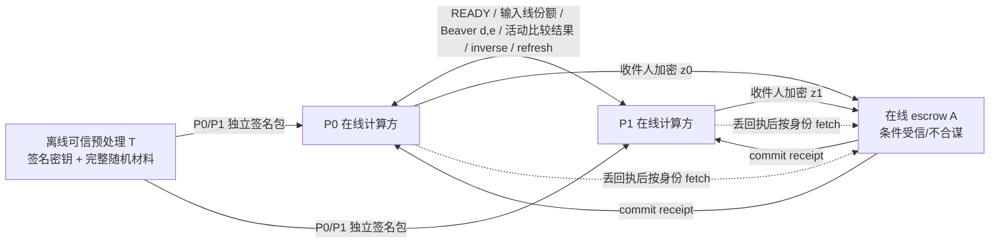

# M6B-I-PROJECT-SELECT-5ITER-S34 独立接收与安全停止报告

日期：2026-10-20  
被审路线：`Protocol I + PROJECT_DERIVED_SELECT_5ITER + GMW/Beaver-v3 / EXPERIMENTAL`  
接收范围：S33 最终修复快照；S34 新发现 SIGPIPE 修复及其定向证据

## 1. 结论

**S33 快照身份：PASS。** S34 从 S33 manifest 记录的 S25 74 文件快照与 S32 15 个增量恢复出的 84 文件接收对象，逐文件重算哈希均一致，canonical SHA-256 为 `7e0f2ab6ae03ae402a739e2f5e97a09aa44a4fb3a373294f860ebb6f441c3df9`。基线 HEAD 是 `c3926c68fd14f270faa8b55234311071947fa080`。源对象核验基于 S33 source/build/evidence manifest 和文件字节，不依据分支名或报告摘要。

**通信/功能接收：PASS_WITH_SCOPE。** 在 exact S33 源码上复现其 transport helper 缺陷：一个不由本次写操作产生、却在成功阻塞 framed write 期间送至该线程的外部 SIGPIPE，被“pending 状态发生变化”逻辑误消费。S34 做最小修复并新增两项 generic transport 回归。第一次只允许 EPIPE 的窄化补丁未通过 READY/TLS fatal-read 故障链，双方仍以 141 退出；这条失败保留。最终修复后，v3 runtime 与 generic framed transport CTest 2/2、无注入正常路径、READY body mismatch、重复 READY、P1 在 Beaver opening 后 SIGKILL、v2 TLS13 专用 transport target 均通过。

**自然 I/O 错误：NOT_REPRODUCED。** 本轮无 failpoint 正常路径中双方均成功；observer 在正常收尾读到 TLS `unexpected eof while reading`，Party 进程已 exit 0、A 已提交、两方 share 已返回。这是 TEST_ONLY TLS 终止代理在 peer close 时报告的收尾现象，不是本轮 party API 的自然读写错误。人工 READY 不一致、重帧和 SIGKILL 是独立注入案例。

**密码学安全：OPEN / NO_GO。** 逐方证明在第一个 package signature 条件分布处停止；A 视图还存在 TEST_ONLY launcher 读取完整 P0 package 的边界越界。没有发现攻击；未发现攻击不能推出通过。T 联合预处理、P0/P1 完整 transcript、A 的密文/崩溃/恢复视图模拟、获准泄露的组合和 OpenSSL 优势量化均未证明。

正式 LAN/WAN 性能矩阵与 RTT 本轮 `NOT_RUN` / `NOT_MEASURED`。S33 的 N=128/N=256 资源观测在本报告中标为历史观测；S34 未重跑 195 案，也未重新测量这两个点。N≤256 功能范围仅沿用 S33 已测具体输入点的 `PASS_WITH_SCOPE`；N>256 `NOT_ADMITTED`。

## 2. 证据类别、继承关系与负责人确认

| 类别 | 本轮依据 | 能支持的结论 |
|---|---|---|
| 论文定义 | S31 冻结规格及本地论文边界 | 本路线没有被证明等价于 BB90 原五迭代算法；不是 BMW16，也不是 BB90+DCF。 |
| 本地参考/冻结 oracle | S31 的功能合同与冻结 `top_k_mask` oracle；S33 195 案记录 | 支持已测 score/tie/order/K 语义；S34 未重跑 S33 的完整矩阵。 |
| 项目派生算法 | S33 84 文件源对象及本轮定向新源码 | 源码事实：GMW/Beaver-v3、全 pair comparator、五次 Select5 控制、在线 A。 |
| 测试观察 | S34 定向 CTest、4 个进程 trace/fault result、v2 TLS target | 仅支持相应二进制、输入、执行环境和注入位置。 |
| 待证明假设 | 理想独立随机带、T/P0/P1/A 非合谋、条件 sampler、原子可见性/恢复模型 | 尚未证成。 |

S31 是规格和 TEST_ONLY 行为审查，未审 S32 runtime；S33 是 S32 的独立 runtime 接收者；S34 未参与 S32 实现，且独立接收 S33 最终快照。S34 仅在新的隔离 worktree 操作；不清理或改动继承未提交内容的 S32/S33 worktree，也不改主工作区中的用户未提交文件。

负责人本轮确认可以将 escrow A 建模为与 T/P0/P1 不合谋的**条件受信**服务，负责逻辑提交可见性和身份受限恢复，不持有 recipient 解密密钥。该确认没有批准恶意 A 安全、可用性、断电耐久性或任意合谋安全。代码/测试仍没有实现 metadata-only 进程隔离：TEST_ONLY `escrow_worker` 收到 P0 package 路径，并在启动 A 前读入、校验完整 package。因此当前 E2E harness 的 A 实际 view 超出确认的 `L_A`，这是 S34 的 A simulator/source boundary 断点，后续准入必须先隔离。

## 3. 精确源码与构建身份

### 3.1 接收重建

沿用 S33 manifest 方法：核对 S25 manifest 的 74 个 hash 与 S32 manifest 的 15 个增量，重叠路径以 S32 hash 为准，84 个唯一文件全匹配 S33 记录的最终 SHA。原 S33 canonical 是 `7e0f2ab6…f441c3df9`，S32 重建基线为 `fbb4b247…552dd38e`。S34 在新 worktree 只叠加 84 个被测清单文件；并未通过清理/重置删除 worktree 中其他未跟踪历史文件。S34 改动该 84 文件集合中的 4 项后 canonical 为 `caa5e162944c20331d6fabded31a419404a37b8228afd6066707b0791bf4a9c4`；另有一个 generic transport regression test 源文件不在 S33 的 84 项 manifest 集合中，作为 supplemental source 单独记录（S33=`eb14b4243bba0ebc0047cf76c0fba7aeef362337dfabfc28b4823b3a939fa94ca`，S34=`34ffe71c1ed77b8f10940d353083cd2071b1f7bd0d493c1d1d69d21b337e0395`）。该工作树逐文件 S34 hash、manifest 输入 hash 和外部证据 hash 见 [S34 manifest](M6B_I_PROJECT_DERIVED_SELECT_5ITER_S34_SOURCE_BUILD_EVIDENCE_MANIFEST_2026-10-20.json)。

S34 worktree：`C:\Users\28641\.codex\worktrees\m6b-i-project-select5-s34-review\MoE_Top-k_Reproduction_Evaluation`。原 S32/S33 worktree、`VFSS-baseline/`、主工作区均未修改。构建、证书、party package、SQLite 数据库和原始执行日志放在 repo 外：`C:\Users\28641\.codex\evidence\M6B_I_S34_20261020_01`。

### 3.2 配置与二进制

| 配置/对象 | 结果和 SHA-256 |
|---|---|
| Fresh Release default-OFF，`sytorch` | PASS；无 v3 symbols/targets；不带 opt-in macro include v3 header 返回预期 `#error`。静态库 `04950d311143c10723e82ba19bbf7bb24c9be819ddd5ed7c244a468dff12366a`。 |
| Fresh Release，v2 OFF / v3 ON，最终 S34 transport | PASS；只启用 `MOE_TOPK_ENABLE_SCORE_TO_MASK_V3_GMW_EXPERIMENTAL=ON`；没有 v2/DCF fallback。 |
| 最终 v3 `libsytorch.a` | `12c2820083b63222210751b5fd8f6d1792c5900461ec18c6c1a5b4cf9d474548` |
| 最终 v3 runtime conformance | `6d638c75aa020ecd5840f745ef8e0cec44c27ca0f8ad79c9a1f11b5d268a3fff` |
| 最终 TEST_ONLY process driver（加入逐帧 read/write 状态、Party counters、重复 fetch/身份边界断言后） | `70dfff40f1cd6f4e67d55c763679bfe2e03abec94c6d0cea9c99d6da88f749a1` |
| 最终 generic transport conformance | `d6bec05d93c70a254024ea2a45ca3475aaa94fed6f5b001fd5bce822589dca21` |
| 独立 v2 TLS13 transport target | `1c4ad04b9c29b14e1446dec3bdda032f3baa36953640cb882901ffc565f4f751`，exit 0 |

源码接收前，S34 fresh ON build 的 runtime conformance 与 S33 manifest 二进制哈希一致；其 fresh `libsytorch.a` hash 为 `8881faabcaa2fcbccf69eabd04db7f4844b76f68d51b2a6cf479d04e54bfaac9`，与 S33 manifest 的 `53acd750…c9a7500` 不同，原因未确定。保存的 S33 原 build artifact 符合 S33 manifest；S34 不把 fresh archive 差异静默解释为一致。最终 S34 修复后，library 和 process driver 哈希按上表另行记录。

构建环境为 WSL2 Ubuntu 24.04 / x86_64、GCC 13.3、CMake/CTest 3.28、OpenSSL 3.0.13。SQLite 开发 headers 由现有本地 deb 解包到临时目录，没有修改仓库或安装新系统包。完整命令、配置日志、`nm`/target/header 探针、binary hash 文件都列在 manifest。

## 4. 角色、消息 DAG 与理想功能

| 角色 | 材料/密钥 | 在线输入/输出 | 真实可见消息与 metadata |
|---|---|---|---|
| T | Ed25519 signing key；全套 Beaver triples 和 permutation；RAND_bytes 随机带 | 不接收用户分数；签发两个 party package 后离线退出 | 看见 session/invocation、公开参数、包内容与签名；是完全可信预处理方。非合谋由本轮模型要求，尚无 T simulator。 |
| P0 | 本方 additive input share；P0 package/lease；TLS identity；P0 recipient RSA private key；对方公钥 | 本地计算 mask share `z0`；A commit receipt 后 API 返回；可用身份凭据 fetch 自己的密文恢复 | P1 frame/打开值/允许结果；phase/seq/tag、长度、TLS peer、Abort/receipt 状态；不应看到 rank/full mask。持有自己的包材料。 |
| P1 | 本方 additive input share；P1 package/lease；TLS identity；P1 recipient RSA private key；对方公钥 | 本地计算 `z1`；提交后返回或恢复 | 与 P0 类似的本方 transcript；收不到 `z0` 或完整 mask。P1 在 S34 被 SIGKILL 案例没有 API return。 |
| A | TLS server identity/cert、SQLite 状态/密文、signed package metadata；源码 service 不读取 recipient RSA 私钥 | 提交两份 opaque recipient envelope、线性化 availability、返回 receipt；认证后只 fetch 对应 recipient envelope | TLS 终止后看见明文 frame 头/请求字段、session/invocation/N/K/party/transaction、ciphertext 与 hash、长度、到达顺序、commit/abort/fetch 时序。测试 launcher 还会 transiently 读取 P0 的完整 package，超出理想 `L_A`。 |

目标理想输出 `F_TOPK-U`：令 `x=(x0+x1) mod 2^32`，signed Q20.12 值降序，score 同分用 original index 升序；令 M 为 Top-K mask。采样均匀 `R∈{0,1}^N`，输出 `z0=R`、`z1=R XOR M`。两份 share 均恢复至原输入顺序，`weight(M)=K`。在提交之前双方 API 都输出 `⊥`；逻辑提交后，两方各自可得到本方 share。提交条件下物理存储/服务回应/客户端 return 可能发生在不同时间。

目标 `F_TOPK-ATOMIC`：材料 lease 在在线开始前一次性烧毁；中止时不释放/重用材料。若 A 尚未逻辑提交，则 API 不返回完整输出 share，且未提交交易按身份不可 fetch；若最终 commit state/receipt 已耐久提交，双方各自可以从 A 恢复 recipient ciphertext，但服务 receipt 丢失方可处于 `RECOVERY_REQUIRED`。该合同依赖 A 的诚实状态机、原子可见性和存储/恢复假设；本轮没做 power-loss 证明。当前源码让两个密文 row 在两次请求 transaction 中分别提交，最终 transaction 插入第二 row 并写 `state=1,receipt`，fetch 仅接受 state=1。因此只有**逻辑 fetch 可见性**原子，不能称两行从未被单独提交。

### 允许泄露的暂定表

| 对象 | 目标泄露 | 明确不在批准泄露中的值 | 实际状态 |
|---|---|---|---|
| P_b | 本方输入 share、本方输出 share、公开参数、S31 `L_S29`：批准的 sample seed/活动比较 outcome、比较/通信长度及统一 abort 范围 | 分数/priority rank、selected index、完整 mask、wire shares、未获准的比较位、Dealer 全包 | `L_S29` 仍是理想目标，不代表模拟已成立。需从实际 READY 与 frame 顺序逐字段证明长度/结果没有额外泄露。 |
| A | 本轮负责人确认的条件受信 A：公开 session/调用参数、认证身份、密文/哈希/长度、transaction commit/abort/fetch 状态、到达顺序/时序；不含明文 share 或 decrypt key | triples、permutation shares、rank、index、完整 mask、wire values | S34 E2E A launcher 实际读 P0 package，违反此 metadata-only 目标。 |
| T | 可信离线 T 可见全部预处理与签名材料；输入无关 | 用户 score/input/在线 transcript | trusted preprocessing assumption；joint distribution 和攻击边界仍待形式化。 |

## 5. 源码审查与材料账本

| 阶段 | 源码事实 | 当前证据/未闭合点 |
|---|---|---|
| signed score & additive shares | party 输入转换成 32 位 Boolean XOR shares；GMW ripple/parallel carry 以 Beaver AND 计算 `(x0+x1) mod 2^32`，没有在运行时解开 score/rank。signed key 以符号位映射到 unsigned 顺序；key 编码稳定分数降序、index 升序。 | N=3/4 oracle、边界/tie cases 属 S33 历史；S34 未重跑全矩阵。按理想输出 share 条件化的 carry/wire view 未证明。 |
| 全体比较与 Select5 | 为所有 unordered pair 分配 lexical comparator，借助 borrow recurrence 求稳定优先级；Select5 控制使用可公开的 sample seed、只打开活动比较边 XOR 结果；membership boundary 生成 secret-shared mask。 | 比较结果自适应选择下一轮时，需证明条件分布与允许 `L_S29` 对齐；通用 GMW 结论不足以自动覆盖这个程序。 |
| 前向/逆路由 | T 提供 XOR-shared one-hot permutation matrix；每 party 按 row/original share 路由 key；选中边界 membership 用 shared permutation inverse route 返回 original order。 | Fisher–Yates / `next_uniform` 的条件均匀性、全 package joint law、与比较 transcript 的组合均未证明。 |
| triples & lease | T 为每个 scheduled gate 生成 `a,b,c=a&b`，两方有 XOR share；每方 package 包含 triples、permutation share、session/invocation、N/K、party identity、circuit/schedule/material hashes、signer fingerprint 与 Ed25519 signature。局部 gate id 查表；exchange 前标记消耗，重复/越界拒绝；one-shot SQLite lease 在 READY 前烧毁；错误后无回滚。 | 正常 gate marker all consumed 是功能账本；joint preprocessor distribution 仍 OPEN。恶意 T/重复 package/durable lease crash 不是安全证明。 |
| frame/transport | TLS 1.3 mTLS、hostname/identity binding；帧头校验版本、phase、sequence、session/material id、发送/接收者、类型、长度；内层 context 再绑 circuit/schedule/tag。`exact()` 循环处理 partial I/O、poll/TLS WANT_READ/WANT_WRITE 和 deadline；EOF、截断、超时、顺序/长度不符抛异常。 | S34 新 helper 在 thread scope block SIGPIPE、区分已有 pending、保存 operation errno、恢复旧 mask；仅 raw `EPIPE` 或 TLS fatal error/EPIPE 才尝试 drain。成功写并发外部 signal 和入场 pending 已有回归。标准信号 coalescing 下“失败 TLS SSL_ERROR_SSL 同时收到无关外部 SIGPIPE”的来源不能由当前 API 绝对区分；这一窄 race 不被测试排除，故不宣称任意信号竞态都证明安全。 |
| 输出刷新/recipient crypto | P0 采样随机 `R`，发 `R XOR original_mask_share` 给 P1；P1 得 `R XOR M`。两份 local share 各自使用 recipient RSA 公钥混合加密封套（RSA-OAEP-SHA256 + AES-GCM），绑定 package 中 RSA fingerprint。 | 需要输出刷新及 recipient encryption 的完整条件分布、密钥管理与 IND-CCA/AEAD 具体参数；未量化。 |
| escrow commit/recovery | A 端校验身份、transaction/session/invocation/N/K/circuit/schedule；重复同密文幂等，冲突密文拒绝；receipt 绑定交易与两密文 hash；fetch 需 recipient identity 且 state=1。提交不确定时 Party 返回 `RECOVERY_REQUIRED`。 | 见前述两阶段 row 物理提交事实与 A launcher material-access 问题；SQLite WAL/FULL/process restart 不证明掉电 durability。A view、crash-prefix/recovery sampler 未写出。 |

S31 的预算 `G≤5,281,664`、每方 package ≤2 MiB、在线单 payload frame ≤1 MiB，以及 N128/N256 预估 phase 上界 90/91，是**设计预算/phase 上界**。S33 实测：N128 `G=1,289,280`、每方 package `485,964 B`、最大 payload `159,852 B`、party peak RSS `25,360 KiB`、88 application phases；N256 `G=5,281,664`、每方 package `1,989,252 B`、最大 payload `655,468 B`、party peak RSS `72,468 KiB`、89 application phases。两点输出 oracle/recovery PASS。以上是 S33 的历史本机诊断数据，S34 未测；实际 phase 88/89 不是 RTT，也不是正式性能数据。

## 6. S34 新 SIGPIPE 缺陷、修复与失败证据

S33 线程 helper 记录 I/O 前 pending set，调用 socket operation 后，只要 `SIGPIPE` 变成 pending 就尝试消费；pending transition 不证明信号来自该 socket I/O。S34 generic regression 对一条大 framed write 施加背压、在 writer thread 运行期间从另一个线程 `pthread_kill(SIGPIPE)`，随后让 peer 继续读取。exact S33 code 下成功 write 会消费外部 signal，transport conformance exit 1，stderr：`unrelated SIGPIPE was consumed by successful framed I/O`。该错误是人工可控测试注入的来源竞态，不是自然网络故障。

第一次最小修复只检查 `result < 0 && errno == EPIPE`。raw socket EPIPE 有效，但 OpenSSL TLS read 在对端提前关闭/发送 fatal alert 时可返回 SSL error 且 errno 不再保留 EPIPE；READY mismatch 仍可使 party 进程因 SIGPIPE 以 exit 141 退出。该尝试及双方完整 case log 单独保留，不能算修复通过。

最终改动在 `socket_operation_without_sigpipe` 增加调用方判定 predicate：raw `write` 仅在 `-1/EPIPE` 时 drain 新 pending signal；TLS wrapper 在 `SSL_read/SSL_write` 后立即保存 `errno` 并调用 `SSL_get_error`，仅在 `SSL_ERROR_SSL` 或 `SSL_ERROR_SYSCALL/EPIPE` 时允许 drain；已有入场 pending 不 drain，始终恢复原 mask 并恢复 operation errno。定向回归包括“成功写期间无关 SIGPIPE 保留”和“入场已 pending 的 SIGPIPE 仍 pending”。最终 v3/generic transport CTest 2/2 PASS。

**窄限制：**POSIX standard signal 可合并；在当前 TLS I/O 自身出现 fatal `SSL_ERROR_SSL` 的同时，如果另一个线程又向当前线程送来 SIGPIPE，仅看 pending set 仍无法辨认二者来源。S34 新回归证明成功 I/O 不消费无关 signal、并保留入场 pending；没有证明这个并发失败路径能区分来源。此残余竞态需要通过更强 socket/TLS alert 发送策略或显式线程信号契约解决，不把当前结果扩大为完整的 signal-origin 证明。

## 7. 无注入通信路径和人工故障注入

每条用独立 session、dealer package pair、party one-shot lease、escrow SQLite DB；v3 timeout 15,000 ms。所有 worker 分 stdout/stderr 保存。完整原始证据路径及文件 SHA 在 manifest；逐帧 observer log 保存应用 phase、outer sequence、tag，以及 framed read/write 的 `OK` 返回和 payload 字节数。party 结果文件还保存该 Party API 的总 bytes/frame sent/received、phase 和 max payload。observer 不读取 Party 进程内部 syscall，也不记录每次 TLS/socket partial `read/write` 系统调用返回长度；syscall 粒度部分完成是 `NOT_MEASURED`，公开代码的 `exact()` partial-I/O loop 不等于本次实测到短读/短写。

### 无注入正常 N=3, K=2

| 进程/状态 | 观测 |
|---|---|
| Dealer | exit 0，fresh package pair 创建成功 |
| P0 | exit 0，API `committed/share-returned`，lease burned，最终 trace 73 phase / frame sequence 0–72 |
| P1 | exit 0，API `committed/share-returned`，lease burned，最终 trace 73 phase / frame sequence 0–72 |
| A/escrow | transaction `COMMITTED`，1 transaction、2 recipient rows；正常结束由测试 harness SIGTERM 服务，exit 143 是 teardown 信号退出，不是服务错误码 |
| TEST_ONLY TLS observer | 转发 73 phase；Party 完成后遇到 TLS unexpected EOF 收尾异常；双方进程和输出校验已经成功 |
| API/oracle/recovery | XOR 结果等于 stable frozen oracle；每方分别 recovery path check PASS；A restart 后各 fetch 仍按 recipient 身份隔离（继承已执行的相关 CTest evidence） |

最终 trace 的 Party framed I/O 计数：P0 sent/received `12,328/12,321` bytes、`73/73` frames；P1 sent/received `12,321/12,328` bytes、`73/73` frames；双方最大 send/receive payload 均为 `244 B`。proxy 每个成功 receive/send 记录 `read=OK` / `write=OK` 与 payload length；phase 1 是 105 B、Beaver phase 2 是 140 B。outer sequence `0..72` 连续，tag 1..6；不代表 syscalls 一次写完整帧。五次不注入诊断 trace 都成功，观察 phase 数为 73/76；这是 Select5 活动执行路径不同的本机计数，不能解释为 RTT。

此条是功能诊断，不报告本机 elapsed 时间为性能；没有自然卡死、读写超时、短读/短写报错或 EOF 造成 party API error，故自然问题 `NOT_REPRODUCED`。`proxy.frames.log` 305 行，phase 从 1 到 76，outer seq 0 到 75；proxy 收尾 `unexpected eof while reading` 与 service teardown `143` 单独记载。

### 人工故障案例

| 注入案例 | P0/P1 API 与进程 | 消费材料 | A 状态/可恢复内容 |
|---|---|---|---|
| READY body mismatch：phase 1 proxy 把 READY body `{1}` 改成 `{0}` | P0 exit 10 `ABORTED/no-share`；P1 exit 10 `ABORTED/no-share`；T exit 0；A SIGTERM exit 143 | 两 lease burned；phase 2/3 清理消息；尚未 gate layer，triple 使用为 0 | 0 transaction / 0 row；本次双方输出 share 均不能从 A fetch。 |
| Duplicate/stale READY：旧 phase 重放到 party | P0/P1 exit 10 `ABORTED/no-share`；T exit 0；A 143 | 两 lease burned；双方进入首轮 Beaver 前缀；按 S33 case，至少首批 gate id 已标 consumed，整包不会重用 | 0 transaction / 0 row；无本次提交输出可 fetch。 |
| Beaver phase 2 后 P1 `SIGKILL` | P0 exit 10 `ABORTED/no-share`；P1 exit 137，进程在 API return 前死亡；T 0；A 143 | 两 lease burned；proxy 捕获 P1 phase-2 response；P1 被杀前 exact process gate/frame counters `NOT_RECORDED`，额外 gate 前缀 `NOT_MEASURED` | 0 transaction / 0 row；无输出从 A 恢复。不能由此声称 P1 从未持有本方 share 或中间 wire。 |

所有上述均为 proxy/SIGKILL 人工注入，不是自然 I/O 复现。成功正常路径中 A exit 143 同样仅表示测试 harness 显式 SIGTERM；各案例日志分开保存。

### A commit / restart / recovery 定向重跑

最终 TEST_ONLY driver 的 `--fault-only` fresh run exit 0，执行三条独立 session/package/lease/DB：

| 案例 | API/提交状态 | 重启与恢复结果 |
|---|---|---|
| commit 后丢 P0 receipt | P0 `RECOVERY_REQUIRED`、exit 11；P1 `COMMITTED`、exit 0；A 收到 SIGTERM 后 wait status 满足 signal-exit 合同 | A 重启后 P0/P1 分别以各自身份 fetch，receipt 相同；解密 share 与已返回 share/冻结 oracle 一致。新增再次 fetch 检查 ciphertext+receipt 完全相同；使用 P0 TLS certificate 去 P1 endpoint 被拒绝。 |
| 首份 deposit pending 时杀 A | 两 party `RECOVERY_REQUIRED/no-share`，process exit 11；两 lease burned | 测试向旧 A 发 SIGKILL，重启服务后 pending record durable 标为 ABORTED；P0/P1 fetch 均被拒绝。A 精确 wait exit code 没有序列化到本次控制台 JSON，故该字段 `NOT_RECORDED`（注入信号为 SIGKILL）。 |
| 首份 deposit 后等待超时 | 两 party `RECOVERY_REQUIRED/no-share`，process exit 11；两 lease burned | A timeout 把 incomplete transaction 标为 ABORTED；服务重启后两方 fetch 均失败。A 子进程精确 wait code 同样未序列化，`NOT_RECORDED`。 |

这些是人工 crash/timeout 逻辑案例，不是掉电或文件系统故障注入。该定向 driver 没保存每个 restart 子进程 stdout/stderr 独立文件；summary JSON line 与 parent stdout/stderr、状态断言保存在 `escrow-recovery-final5.*`。其 elapsed 数值只是本机诊断，不作正式性能记录。

### 保留的失败尝试与重跑

- Exact S33 SIGPIPE-origin probe 按设计构造并发信号，旧 helper 失败并输出 `unrelated SIGPIPE was consumed by successful framed I/O`；该失败用来定位缺陷，明确属于人工注入。
- 只按 `errno==EPIPE` drain 的第一修复在 READY/TLS fatal-read 案例仍出现 party SIGPIPE exit 141；修复前后源码/二进制与 logs 均留存，没有把它记为通过。
- 首版 shell wrapper 在 Windows→WSL 换行处理下，末尾 `cat`/`exit` 参数带 CR，wrapper 返回 2；其内 normal/fault test process 自身状态已记录为 0，但不把该 wrapper 当作最终通过。改用 LF 脚本重跑后，`final4` 和最终包含恢复/重复 fetch/identity check 的 `final5` wrapper 均 exit 0。
- 一次之前的失败 trace 在临时目录留下本轮启动的 escrow service 进程，生成 evidence hash 时因其持有 stderr 文件而阻塞。确认进程 command line 属于本轮 test binary 后向该单一 PID 发 SIGTERM，随后确认其已退出；没有删除临时目录或覆盖日志。最终 `final5` 全链路重新跑过，结果独立记录。

上列失败/重跑和所有最终双方 stdout/stderr、case JSON、proxy frame trace、CMake/CTest logs 均保存在仓外证据目录，并由 manifest 逐文件列 SHA-256；失败记录没有从目录中删除。

## 8. 单方模拟/组合证明尝试及首个精确停止点

### 8.1 规定 sampler

目标 PARTY sampler 按 S31 接口应以 `(x_b, z_b 或 ⊥, public parameters, L_S29)` 为输入生成完整 party view：收到的 T package、全部 phase/sequence 帧、所有 Beaver `d/e` opening、线份额、获准自适应比较结果、shuffle/inverse、输出刷新、A deposit/receipt、恢复 fetch 与任意 abort prefix。`L_S29` 不含 package full contents、triple tapes、permutation shares、rank/index、完整 mask 或未批准 wire。A sampler 应按负责人确认的 metadata/ciphertext-only `L_A` 生成 TLS endpoint 可见帧、交易、两种提交顺序、重启、receipt 丢失与 identity-bound fetch。

### 8.2 PARTY 的首个不可模拟字段

S31 sampler 既无 T signing key，也无 `F_T` 签名 package 预言机。真实执行在 READY 之前先读/验包：package 有固定 T public key 下对 header+material 的 Ed25519 签名，尾部精确 `sig[64]`。针对 sampler 的简单检验器只需解析 package 并用已公开 T 公钥验证签名：真实值验证成功；若 sampler 仅按允许输入自行采包，它不能生成对应固定 signer 的签名。这说明指定 sampler 缺少真实分布的生成接口。它不是签名伪造攻击，也不证明密码算法不安全。

因此停止向后 hybrid；不声称已证明下列替换：Beaver openings 的 conditional uniformity、输入转换及中间 wire 在固定 `z_b` 下的联合分布、Select5 adaptively chosen active-edge outputs、shuffle/permutation correlations、inverse mask、P0 refresh `R`、recipient ciphertext、receipt/recovery 与 abort prefix。**最小修正：**把可信离线 preprocessing 明确为理想 `F_T`，令 sampler 可请求同分布且 session-bound 的 party package/signature，而不泄漏 T private key；形式化证明 package 的 joint law 后再往在线 transcript 逐步 hybrid。后续必须经独立 reviewer 复核。

### 8.3 A 的首个 view mismatch

生产 service config `ScoreToMaskV3PackageInfo` 是 metadata 值且 service 没有 recipient private key；但 TEST_ONLY `escrow_worker` 在运行 service 之前通过 `argv[3]` 取 P0 package 路径，调用 `score_to_mask_v3_validate_package`，该函数会读 whole file、校验 material hash/signature。故实际测试 A 进程的执行环境可访问 triples/permutation package body。metadata-only `Sim_A(public,L_A)` 缺少生成该 package body 的获准输入，且该材料不是 `L_A`。第一个可检验不匹配字段是 P0 package body 的 local triple/permutation share。负责人已确认 A 的条件信任边界；这不自动允许把未批准材料默默加入 `L_A`。最小修正为 metadata-only signed context、A 进程无 party-package 文件权限，并以负向打开文件测试证实隔离。

### 8.4 其它方及优势项

T 的全包 triples 与 permutation shares 需要展示跨 gate 的联合分布、独立性和输出条件；局部随机/频数不能证明这一点。A 模拟必须覆盖 ciphertext、同一逻辑 commit point、pending row、receipt 与崩溃/恢复时序。P0/P1 adaptive active comparisons 的组合必须证明只有批准的 outcomes 可见，不泄露额外 rank/index。RNG、Ed25519、SHA-256、RSA-OAEP/AES-GCM、TLS mTLS 及 timing/abort composition 可保留符号项，但不能报未算的 bits；候选记号 `ε_total = ε_F_T + Adv_DRBG(q) + Adv_Ed25519 + Adv_SHA256 + Adv_RSA-OAEP/AES-GCM + Adv_TLS + ε_adaptive-L + ε_timing + ε_atomicity/model` 只是缺项清单，不是已经推出的定理界。

## 9. 性能、门禁与后续

本轮没有启动正式 LAN/WAN 矩阵，没有采样 RTT。算法“5 iterations”、比较依赖层 `W`、程序实际 exchange phase、物理网络 RTT 分属不同量，不互相换算。S33 N128/N256 历史观测与 S31 预算/上界已经分表列示；本轮新的 phase 76 只来自 N=3 本机 observer trace，也不是 RTT。

| Gate | 状态 |
|---|---|
| S33 84-file exact receive | PASS |
| S34 final source identity and targeted binaries | PASS；fresh ON archive 与旧 manifest archive hash 有未解释差异，详见 §3.2 |
| default-OFF/no-symbol/no-target/header rejection | PASS |
| explicit v3 ON/no v2 fallback | PASS |
| normal v3 multi-process trace | PASS_WITH_SCOPE |
| natural I/O fault reproduction | NOT_REPRODUCED |
| three injected communication cases | PASS_WITH_SCOPE |
| generic transport external/preexisting SIGPIPE regression | PASS_WITH_SCOPE；TLS concurrent fatal-error source ambiguity remains |
| v2 dedicated TLS13 target | PASS |
| 195 full E2E matrix in S34 | NOT_RUN；S33 exact source has historical 195/195 evidence |
| N128/N256 resource re-measurement | NOT_RUN；S33 values historical only |
| P0/P1/A/T full-view security proof | OPEN / NO_GO |
| A metadata-only source isolation | OPEN |
| SQLite power-loss durability | NOT_MEASURED |
| RNG/signature/encryption/TLS advantages | NOT_QUANTIFIED |
| N≤256 scope | PASS_WITH_SCOPE for S33 tested points only |
| N>256 | NOT_ADMITTED |
| formal LAN/WAN and RTT | NOT_RUN / NOT_MEASURED |
| v3 secure alias/default ON | NOT_CREATED / OFF |

下一版最小序列：先给 P0/P1 simulator 添加安全的 `F_T` package oracle，再从 TEST_ONLY/production launcher 移除 A package 文件读取并加 OS 权限回归；修订 `F_TOPK-ATOMIC` 表述以明确 durable pending row 与最终 visibility linearization；逐条补全 joint material law 和 party/A simulator，交由未参与推导者复核。没有通过这些证明门前不讨论 secure alias。性能门仍以后续 V3→V4 gate 通过为前提。

## 10. S34 修改文件

本轮共修改/新增 10 个仓库文件：

1. `VFSS/src/moe_topk/protocol_i_transport.cpp` — 区分本次 I/O SIGPIPE 与并发/预先 pending signal；保留 errno/mask 并处理 TLS fatal I/O。
2. `VFSS/tests/moe_topk/protocol_i_transport_conformance_test.cpp` — 成功写期间并发外部 SIGPIPE、进入时已有 pending SIGPIPE 回归。
3. `VFSS/tests/moe_topk/score_to_mask_v3_process_e2e_test.cpp` — 正常/故障 trace 输出补充 Dealer 与 A 状态/退出码。
4. `PROJECT.md` — S34 接收与 security/性能状态。
5. `docs/IMPLEMENTATION_PLAN.md` — S34 范围、结果、停止条件。
6. `docs/decisions/M6B_I_PROJECT_DERIVED_SELECT_5ITER_S34_DECISION_2026-10-20.md` — 负责人确认的 A 假设与接收决策。
7. 本报告。
8. `docs/reproduction/M6B_I_PROJECT_DERIVED_SELECT_5ITER_S34_GATES_2026-10-20.json` — 机器门禁。
9. `docs/reproduction/M6B_I_PROJECT_DERIVED_SELECT_5ITER_S34_CASES_2026-10-20.json` — 定向 case、normal trace、保留失败。
10. `docs/reproduction/M6B_I_PROJECT_DERIVED_SELECT_5ITER_S34_SOURCE_BUILD_EVIDENCE_MANIFEST_2026-10-20.json` — 84 file source、build binaries、依赖/输入/外部 evidence hashes。

没有修改 `VFSS-baseline/`、论文、密钥、certificate、party package 或仓外 build/raw log；未提交 commit/PR。
