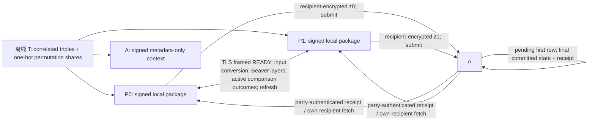

# M6B-I-PROJECT-SELECT-5ITER-S35 独立接收与条件安全复核

日期：2026-10-21
准确路线：`Protocol I + PROJECT_DERIVED_SELECT_5ITER + GMW/Beaver-v3 / EXPERIMENTAL`
对象：S34 最终修复版 84 文件快照及集合外 generic transport conformance 源；S35 的版本化源码修订。
结论：**运行时/隔离修正 `PASS_WITH_SCOPE`；整体安全 `OPEN / NO_GO`。**

## 1. 裁决摘要

S33 原始运行时未通过独立接收：S34 对其复建时复现了 SIGPIPE 清理缺陷。S34 修复版的定向回归通过，但当时尚未由非作者最终接收。本轮从 S34 最终修复快照开始，在独立 worktree 复核并加入 metadata-only escrow context、package/context 签名域分离、A 的进程材料隔离和 TLS 身份校验顺序修正。最终 Release v3 构建的 195 条 oracle E2E 全部通过，N=128/256 边界记录通过；相关 transport、v2 TLS、escrow 身份/重启和默认关闭门通过。自然多进程 I/O 故障 **`NOT_REPRODUCED`**。

新增 A 的模型以用户已确认的条件信任为前提：A 与 T/P0/P1 不合谋，只执行逻辑提交可见性与身份绑定恢复，不持有 share 解密密钥。测试服务只读取由 T 签名的元数据 context；root 测试 launcher 将服务降至 uid/gid 65534，并验证其打不开 P0/P1 package。此证据关闭 S34 的 TEST_ONLY package 越界；不证明恶意 A、安全合谋、掉电耐久性或全系统服务可用性。

协议证明推进到实际 Beaver 与公开比较消息：给出 `F_T/v1` 精确输入输出和可信 setup 假设；对单方独立 gate tape、均匀 masked opening、approved `L_S29` 的边界和 A 的 `L_A` 建立候选逐步 hybrid。**停止点**是 Select5 首个活动比较公开时，活动 XOR 结果条件下完整局部 Beaver/wire/package 前缀的联合分布等式尚未证明；没有 simulator 可按本方输入、理想本方 share、公开参数和既有 leakage 生成该条件分布。它是证明缺口，不是攻击，也不由功能 E2E 关闭。A-only ciphertext/重启模拟与加密优势量化也仍开放。

正式 LAN/WAN、物理 RTT、性能矩阵均 `NOT_RUN / NOT_MEASURED`。算法五次迭代、比较依赖层 `W`、程序 exchange phase 和网络 RTT 分开报告；不创建 `secure` alias，v3 默认关闭，N>256 `NOT_ADMITTED`。

## 2. 来源身份、工作区与证据分类

开始前读取 `AGENTS.md`、`PROJECT.md`、`docs/IMPLEMENTATION_PLAN.md`、S31 决策/报告/gates、S32 决策/报告/gates、S34 决策/报告/gates/manifest。S34 manifest SHA-256 为该文件清单的逐项哈希来源；S34 84 文件规范 canonical hash 为 `caa5e162944c20331d6fabded31a419404a37b8228afd6066707b0791bf4a9c4`。本轮将 S34 所列 84 路径逐一对照；最终 S35 对其中 9 个文件有意更新，并加入原 S34 清单外的 `VFSS/tests/moe_topk/protocol_i_transport_conformance_test.cpp`，完整规范源码清单共 85 项，S35 canonical hash 为 `af693eb61183a606c64a1f1b16ee5c3ad6e4b382ec5456e541c7915b8f95faa0`。具体逐项 hash、S34→S35 delta、构建和仓外证据 hash 见配套 manifest。

S31 是规格/TEST_ONLY 与输出/泄露合同复核，不是 v3 runtime 接收；S32 是作者实现和功能记录；S33 是对 S32 runtime 的独立接收，但 S34 随后找到 S33 SIGPIPE 缺陷；S34 对修复作定向复测但未完成最终非作者接收；S35 当前审查者没有编写 runtime 修订，并对最终修复对象复建、回归及 metadata-only A 边界作独立审查。既有 S31–S34 报告和来源对象不覆盖或改写。

证据分类：

| 类别 | 本轮采用的内容 | 结论边界 |
|---|---|---|
| 论文定义 | Protocol I 及论文所述算法 | 未证明本路线就是 BB90 五迭代或 BMW16；不作论文等价结论。 |
| 本地规格/参考 | S31 的 `F_TOPK-U`、`F_TOPK-ATOMIC`、`L_S29`，冻结 stable Top-K oracle | 用作项目理想合同，不把历史 TEST_ONLY 结论扩写为全域证明。 |
| 项目派生/源码事实 | Select5、GMW/Beaver-v3、电路、T packages、在线 A、SQLite 状态机 | 只描述该源码和对应版本。 |
| 测试观察 | 本轮 fresh build、195 案、N128/N256、trace、故障注入 | 正确性/隔离/错误处理证据，不是密码学安全证明或 LAN/WAN 性能。 |
| 待验证假设 | `F_T` 随机带、静态半诚实模型、密码学优势、A 的条件信任和存储模型 | 明确列于安全门，不写成 PASS。 |

本轮工作在隔离 worktree `m6b-i-project-select5-s35` 完成。S32/S33/S34 原 worktree 和原桌面 worktree均未清理、reset、覆盖或顺手提交；`VFSS-baseline/` 无差异。没有密钥、party material、证书、构建物或原始大日志进入提交。

## 3. S35 源码修订与独立审查

### 3.1 Metadata-only escrow context

party package schema 升到 format 4；escrow context 为 version 1。context 仅含 session/invocation、N/K、P0/P1 与 A 身份摘要、circuit/gate-schedule hash、两个 party package 的 hash 与 package-set digest、T signer fingerprint、状态机参数和 T 签名。类型中没有 party package 路径、`PackageInfo`、triples、permutation shares、输入或输出 share。

Party package 和 escrow context 使用不同 purpose domain；签名输入在 domain 后加 NUL、格式版本和 canonical body。context 中的 package hashes 将服务状态绑定到 T 签发的两个 party package，但不让 A 获得 package 内容。conformance 正反例拒绝 package 当 context、拒绝 context 当 package，并检查 context 远小于 package。用户给出的“可信预处理模拟接口”在规格上冻结为 `F_T/v1`（第 5 节）：模拟器请求签名 package/context 时调用 setup/signing oracle，不持有 T 私钥。

### 3.2 A 服务隔离、身份与异常面

服务配置与 launcher 只传 signed context 路径和 T 公钥，不传任一 party package 路径或完整 `PackageInfo`。我以 Ubuntu 24.04 WSL root 身份重新运行最终 process E2E binary（runner UID=0，binary SHA-256 `f511f262e574ddb430317894f63a97e725dd0a62e3f475e21bd44f0da94984ba`，退出码 0）；root-only 分支将 A 降为 uid/gid 65534、检查两个 package 的 `open()` 均返回 `EACCES`，并断言 `/proc` 服务 UID、argv 不含 package 路径且含 context。该运行含 195 案，195 个 oracle 均通过；stdout SHA-256 为 `5908e72b9af8440e43b8c3738767f8165f3f8cf50c9b9f4fedf9ec3c1d1a0a0f`。完整执行身份、binary、stdout/stderr 和逐案计数见 manifest。服务 `RLIMIT_CORE=0`；A 的输出只记录请求 party 和错误摘要。A 使用自己的 TLS server identity，启动时将本地 A 证书 SHA 与 signed context 中的 A identity 比较；每个连接完成 TLS 身份认证、核对对端精确 certificate pin 后，才发送 `AREADY` 应用帧。客户端完成 TLS 握手并核验 A 的 pin 后，才接收 READY/发送请求。相同 CA、相同 DNS SAN、不同证书 pin 的集成负例实际覆盖客户端对 A 的检查；它在客户端发应用请求前失败。服务端对 party pin 的 READY 前检查已由独立审查确认，但本轮没有同 CA/SAN、错误指纹的服务端集成负例。恢复路径另有 P0 身份尝试读取 P1 recipient 交易并被拒绝的负例。

本轮权限证明是当前 Linux/WSL 测试 harness 的进程隔离证据。正式部署仍需让服务管理器维持同等文件 ACL、核心文件和临时目录策略；不从一次测试宣称任意 host 配置均隔离。

### 3.3 S34 SIGPIPE 修复复核

transport helper 在 socket I/O 前记录线程已有 pending SIGPIPE、屏蔽线程 SIGPIPE、执行 I/O 后检查新 pending 状态，并只在本操作确有 socket 失败证据时消费本次产生的信号；然后恢复原 mask 并恢复 I/O 的 `errno`。TLS handshake/record 操作在同线程清空 OpenSSL error queue、设置 `errno=0`、执行 SSL 操作，立即捕获 errno 并调用 `SSL_get_error`；EPIPE 判据使用当前系统调用的 EPIPE 与新 pending SIGPIPE，不把任意 `SSL_ERROR_SSL` 都当作 SIGPIPE 来源。S35 新增 stale OpenSSL error queue 与 TLS 握手开始前 peer 已关闭的定向测试；该用例不覆盖 handshake 中途关闭、partial ServerHello 或 alert 写路径。通用 transport 保留已有 pending/external signal 回归。

仍有明确支持边界：若无关线程定向 SIGPIPE 恰与本线程 socket 写新产生的 SIGPIPE 并发，POSIX pending 集合会合并，helper 无法仅由 pending 状态证明信号来源。该同一时间竞态未被全证明；本轮没有声称完全 race-free。对 `sigpending`/mask API 本身失败、信号到达与 pending 快照并发等极窄失败路径也不作超出测试的保证。

## 4. 固定角色、腐化模型、理想输出和泄露

### 4.1 角色与模型

| 角色 | 能力/持有物 | 本轮模型 |
|---|---|---|
| T：可信离线预处理方 | 知道自己生成的全局 triple/permutation tape，持签名私钥；发两份签名 package 与一份签名 context 后离线退出 | 可信 setup oracle、排除腐化集合；不收输入/在线 transcript；T+任一 party 合谋不在目标模型。 |
| P0/P1：在线计算方 | 各持自有 32-bit additive input share、各自 T package、各自 recipient RSA private key、TLS 身份；仅取得本方 mask share | 分别分析静态半诚实且另一 party 不腐化；T 和 A 排除腐化集合。恶意 party 不涵盖。 |
| A：在线 escrow | signed context、A TLS key/cert、SQLite 密文与 transaction/receipt；无 recipient 解密 key | 用户确认的条件受信、与 T/P0/P1 不合谋，只负责逻辑提交可见性及身份受限恢复。另单独定义 A-only 半诚实视图；不与 party 腐化模型合并。恶意 A、A+party 合谋、A+T 合谋不涵盖。 |
| 网络/存储环境 | TLS record、文件系统、SQLite/OS | TLS/密码学项依赖下文符号假设；掉电持久性、恶意 OS、备份泄露未证明。 |

### 4.2 `F_T/v1` 可信 setup/signing 接口

公开输入：`(protocol=v3, session, invocation, N, K, party/A certificate hashes, recipient public-key hashes, circuit hash, gate-schedule hash, resource/state parameters, T verification key)`。不输入任何分数、输入 share、rank 或 mask。一次调用返回：

1. `P0` 与 `P1` 各自的、只包含自己 xor-shared Boolean triple 与 permutation share 的格式化 package；
2. 每份 package 的规范 header/material digest、party/session/invocation/circuit/gate id 范围和固定 T 验证公钥下的有效 signature；
3. metadata-only escrow context，含两个完整 package hash 和 package-set hash，并带独立 context-purpose signature；
4. 两方各自 one-shot lease 初态。

模拟器可调用理想 `F_T/v1`/setup-signing oracle 取得与固定验证公钥相容的真实分布 package/context；不得持有、调用或从在线 party 取得 T 私钥。生成律按实际 issuer 源码：每个 gate 从 CSPRNG byte 取独立 `a,b,a0,b0,c0`，令 `c=a&b`、P1 shares 为总值 xor P0 share；permutation 由 rejection-sampled Fisher–Yates 构造，one-hot matrix 每格独立随机 xor-share；package 与 context 分用途签名、绑定材料/双包 hash。若把 RAND_bytes 输出替换为理想独立均匀带，则上述关系是精确的；真实 OpenSSL CSPRNG 的联合分布替换需保留符号项 `Adv_DRBG(q)`，不得写成信息论独立或量化具体位数。

### 4.3 `F_TOPK-U` 与 `F_TOPK-ATOMIC`

公开输入 `(N,K,32-bit two's-complement Q20.12,session,invocation,route)`，重构语义为 `x=(x0+x1) mod 2^32`。功能结果 `M` 是 signed score 降序、相同 score 按原 index 升序的稳定 Top-K 原序 bit-mask，恰 K 位为 1。成功 share law：`R ← {0,1}^N`，P0 获得 `z0=R`，P1 获得 `z1=R xor M`，每方只有本方 share。

原子状态机：

```text
ABSENT → PENDING(one recipient ciphertext may be committed) → COMMITTED
                  ↘ ABORTED (timeout / pre-commit restart)
```

只有 `COMMITTED` 可 fetch。源码的第一次 submit 可在自己的 SQL transaction 中持久写一行 ciphertext 与 pending 状态；收到第二方时，在新的 SQL transaction 中写第二行，并在**同一个最终 transaction**更新 `state=COMMITTED` 和 receipt。故共同逻辑可见点是最终 state+receipt commit；两行不是第一次同时插入同一 SQL transaction。服务回执在网络上分别到达，两个 API 物理 return 可不同。丢 receipt 后以 session/invocation、TLS party identity、transaction 和 package context 绑定恢复本方密文；重复 fetch 返回相同 ciphertext/receipt。pending 服务重启按策略转 ABORTED；已 COMMITTED 不回滚。SQLite WAL/FULL 等设置不等于已测得掉电 durability。

`⊥` 表示 API 不返回 share；它不表示本地 stack/wire 内从未形成暂存 share。commit 前 abort 会 burn 已消费 one-shot lease；commit 后恢复不退回 `⊥`。

### 4.4 泄露表

| 观察者 | 获准 leakage | 明确不许可或不获知 |
|---|---|---|
| P_b | 本方输入 share、公开参数/包绑定、本方 package 及本方内部完整 view；S31 `L_S29` 批准的 sample seed、匿名活动边/pivot/活动比较 XOR outcome、公开掩码值、比较数/消息长度、统一 abort、本方输出 share。实际 frame phase/sequence 必须是 public 参数或上述控制结果的确定函数。 | peer 输入/share、完整 mask、score/rank、原 index 到匿名位置映射、selected original index、未打开 comparator、内部随机带/peer triples/permutation、T 私钥。将本方真实 package 纳入 simulator 只通过 `F_T` oracle；不是额外泄露字段。 |
| A | signed context 中 session/invocation、N/K、party/A identity、circuit/gate-schedule hashes、两个 party package hashes/package-set digest、状态参数；TLS peer ID、密文 bytes/hash/长度、到达顺序/时间、pending/commit/abort、receipt hash、认证 fetch/restart 时序。该集合记为显式新增 `L_A`。 | Beaver triples、permutation shares、输入/输出 shares、recipient 解密私钥、分数/rank/index/完整 mask/内部 tape。密文安全只在符号加密/TLS 假设内；package hash 不是完美隐藏承诺，必须计入 `L_A`。 |
| T | 离线生成的相关预处理、签名 package/context metadata | 不能接收 online inputs、rank、transcript；其 trusted-and-noncolluding 假设排除 T view 模拟。 |

`L_A` 是新增接收者而非旧两方 `L_S29` 的别名；两者分开模拟。A-only corruption 模型以 `(public,L_A)` 采样 A view；P_b corruption 模型把 A 视为可信服务且不将 A view/密钥交给 P_b simulator。不能将“不合谋受信 A”和“腐化 A 可单独半诚实观察”合成一个笼统模型。

## 5. 实际源码消息 DAG 与材料账本



在线因果序列为：包与本地参数预检 → one-shot lease burn → P0/P1 READY → additive 32-bit score shares 的逐位模 `2^32` 加法 → dealer permutation share 的秘密前向路由 → 全 pair priority-key borrow comparator table → Select5 公共 sample seed 与活动比较结果的自适应控制 → membership boundary → permutation 逆路由为原序 mask share → P0 输出刷新并向 P1 发送固定 N 的 `R xor m0` → 各自 recipient encryption → A pending/commit/receipt → API return，或 commit 后按身份 fetch recovery。正常 trace 的 party frames 由 session/invocation/circuit/schedule/party/phase/tag/length 绑定；A endpoint 在 TLS 证书 pin 成功前不发应用 READY。

| 材料/状态 | 生成/绑定 | 消费与失败 |
|---|---|---|
| Beaver triples：`G=63N+N²W+C(N,2)(2W−1)+N²`，每门 `(a,b,c=a&b)` 三份 xor bits | T 离线、package signer；gate id 被 circuit/schedule hash 覆盖 | `and_layer` 对 gate id 做范围/重复检查并在 I/O 前标记 consumed；成功所有 gate 必须消费；lease database 对 package hash/session/invocation/party 唯一，异常后 burn、不可重领。 |
| N×N one-hot permutation shares | T 生成 permutation 与矩阵后按 bit xor-share，绑定包 | 前向路由 key、逆向路由 mask；任何本方 package 不交 A。 |
| P0 output refresh `R` | 在线 P0 `RAND_bytes`；不是 Dealer package 里的刷新带 | P0 得 `R`，P1 由 `R xor m0` 与本地 `m1` 得 `R xor M`；提交前只在 party-local pending state。 |
| Party package/context signature | T 固定 Ed25519 verifier identity；v4 package 与 context v1 purpose/version domain 分离 | party parser 与 escrow context validator 互相拒绝对方格式；context hash 绑定双包摘要。 |
| A ciphertext rows/receipt | 两方 recipient RSA envelope；A 按 session/invocation/party transaction 约束 | 第一行可 pending；第二行与 committed receipt 同一最终 transaction；重复相同 submit/fetch 幂等，异值重放拒绝；pending restart/timeout abort。 |

五次算法迭代、GMW compare dependency width `W=39/40`、运行时 88/89 application exchange phases、正式网络 RTT 是四个不同指标。S31 DAG 的 `W+51=90/91` 是设计阶段上界，不是本轮测得值。

## 6. 条件 simulator/hybrid 与首个精确停止点

目标 PARTY sampler：`Sim_b(x_b,z_b 或 ⊥, public, L_S29)`；目标 A sampler：`Sim_A(public,L_A)`。P0、P1 分开模拟。以下是本轮可支持的条件步骤，不表示组合证明已经完整。

| 顺序 | 源码转录与替换 | 候选条件依据 | 状态 |
|---|---|---|---|
| H0：setup/package | 替换 party package、metadata context、签名/摘要、lease 初态 | `F_T/v1` 输出与本轮源 issuer 同分布；固定公钥验签。诚实 T/不合谋、理想独立 tape；实装替换损失保留 `Adv_DRBG(q)+Adv_Ed25519+Adv_SHA256`。 | **接口闭合；联合随机带与标准优势仍为条件假设。** |
| H1：READY/transport preamble | 替换包验签后固定身份/参数 READY 与 framing | phase/session/invocation/circuit/schedule/tag/length 由 signed public fields 和固定程序次序决定；mTLS/pin/EUF-CMA 假设；对失败使用 uniform abort。 | `CONDITIONAL`；OS/网络时序不纳入无泄露保证。 |
| H2：输入 share → ring add | 对每个 gate，用 fresh T triple 生成 masked d/e 与本地 XOR share | 对单门，给定某 party 的 input 与 triple share，peer 的 `d=x_peer xor a_peer`、`e=y_peer xor b_peer` 在 ideal independent triple tape 下均匀；opening `D=d0 xor d1=x0 xor x1 xor a`、`E=...` 对全局输入均匀。模 `2^32` 进位的 63N 门输出关系由 Beaver 公式逐层维持。 | **局部门 conditional opening lemma 可推；未完成对后续 adaptive outputs 和最终输出条件的全局归纳。** |
| H3：forward route + all-pair compare | permutation-share 路由；全 pair borrow recurrence 的 GMW 层 | xor-shared one-hot matrix 及 unique priority key；`key` 表示 signed-score 降序/原 index 稳定次序。fresh gate triples 可支持 H2 局部替换；门 id/一次消费固定。 | `CONDITIONAL`；无 paper-equivalence 或完整 local view theorem。 |
| **H4：首个 Select5 opened compare** | `compare_wave` 把本地 `local_bits` 与 peer bits 作为 frame，随后计算 `result[i]=left xor right`；下一活动边依赖已开 outcome 与 public seed。对应 `score_to_mask_v3_party.cpp` 的 `compare_wave` / `kTagOpenedCompare`。 | 目标 L 允许该活动边的 XOR outcome、sample seed、匿名图控制、长度和计数；但仍需从 `(x_b,z_b,public,L_S29)` 采样完整本方 package-conditioned wire/triple 前缀与 open-share frame。缺少可核验等式：`Law(V_b^{prefix}, local_bits, peer_bits | x_b,z_b,public,L_S29) = Law(Sim_b(...))`。`F_T` 解决签名生成接口，不自动推出此 output/leak-conditioned joint law。 | **首个当前无法闭合的条件等式；在此停止向后组合。不是攻击。** |
| H5：membership/inverse | `selected_position` 生成秘密 membership，再用 permutation shares 逆路由 | 需证明只依赖 approved opened outcomes、不得把 tau/original mapping 或内部 mask wire 放进 L。 | `NOT_PROVED`（按停止条件不外推）。 |
| H6：output refresh/encryption | P0 新鲜 R；P1 得本方 share；recipient RSA/AES envelope | 每方输出边缘均匀仅在 ideal random R 下；模拟 A ciphertext 需 RSA-OAEP/AES-GCM IND-CPA/AEAD 条件，TLS 需相应协议优势。 | `CONDITIONAL/NOT_QUANTIFIED`。 |
| H7：pending/commit/receipt/fetch/crash prefix | A 按 context-bound transaction 写 pending、最终 state+receipt，恢复本方密文 | 用户条件信任 A 的 linearization、availability 和不合谋假设；P_b 的 deposit/receipt/fetch 前缀还需与 `z_b/⊥`、`L_S29` 联合模拟。 | 功能状态机有定向观察；逐方/A 完整 simulator、掉电耐久性未证明。 |

### 6.1 可检验的停止点探针和最小修正

不应把缺少 sampler 写成攻击。复核器可对同一 `N=2,K=1` 的缩小 Boolean circuit 与实际 framing 写一个 TEST_ONLY 采样器：固定 P_b input、指定 ideal share、指定第一条活动 comparison outcome；枚举/采样合规 `F_T` gate tapes，逐字段比较本方 package-conditioned gate transcript、两方 opening share、phase/length 与指定 `L_S29` 的条件分布。固定 deterministic seed/outcome，检验模拟器支持集/概率是否一致；frame checker 另断言 outcome 与 edge 列表可由 approved L 推出、没有额外 comparator bit。该探针尚未作为本轮攻击测试执行，记录为 `NOT_RUN`；无区分器结论。

最小修正不是改 comparator 或扩张 L，而是建立仅供证明/TEST_ONLY 的 `Sim_GMW-Beaver/v1` 逐门条件 sampler，并将 `F_T/v1` oracle 接到 P0/P1/A 三个独立模型；让未参与推导的接收者证明 H4 等式、检查剩余 hybrid 后，才能考虑条件安全入口。若 H4 必须额外给 simulator 原始 rank、tau、index、peer package/tape 或未批准比较位，则当前合同下不准扩 L，应重新设计 Select5 transcript 或明确由负责人批准的新泄露版本。不得创建 `secure` alias。

### 6.2 A-only 模型与符号优势

单独半诚实腐化 A 时，T/P0/P1 仍排除腐化集且不与 A 合谋。候选 `Sim_A(public,L_A)` 按 context 生成签名 metadata、TLS identity、交易状态/顺序/时序；按已观察长度采样不透明 recipient ciphertext；在 `COMMITTED` 时输出 context-bound receipt 与 recipient-specific fetch 重放。源码不交给 A recipient private key，也不将 package body 交给 A。仍需写出 IND-CPA/AEAD 条件下 ciphertext 的 indistinguishability、签名不可伪造、TLS 记录隐私的正式 hybrid；本轮未完成 A simulator。

任何未来总界仅可写符号候选，例如 `Adv_total ≤ ε_FT + Adv_DRBG(q) + Adv_Ed25519 + Adv_SHA256 + Adv_RSA-OAEP/AES-GCM + Adv_TLS + ε_GMW-conditioned-L + ε_abort/timing + ε_A-model`。当前各项都未被实际 query/resource bound 量化，且 H4 尚未闭合，所以这不是已经证明的定理界。

## 7. 构建、定向测试、通信与资源观察

构建环境：Ubuntu 24.04 WSL2 x86_64、GCC 13.3、CMake 3.28.3、OpenSSL 3.0.13、SQLite runtime 3.45.1；fresh Release 三配置位于 `/tmp/m6b_i_s35_20261021_01`。完整命令和 artifacts hash 见 manifest。

| 配置/测试 | 本轮结果 | 证据解释 |
|---|---|---|
| default-OFF Release | `PASS` | 无 v3 target、无 v3 archive symbols；无 opt-in macro include v3 header 按预期编译拒绝。 |
| 显式 v3 ON Release | `PASS` | 只有显式 GMW-v3 target/入口；没有 v2/DCF fallback。runtime conformance、package/context cross-use、one-shot lease、输入/材料错误回归通过。 |
| v2-only TLS Release | `PASS` | v3 OFF 下 v2 专用 TLS13 target 与 M2 transport target 构建/运行。 |
| generic framed transport / TLS conformance | `PASS_WITH_SCOPE` | pending 与外部 SIGPIPE、stale OpenSSL queue、TLS 握手开始前 peer-close、v2 TLS路径通过；handshake 中途关闭未测；同一时间并发不相关 SIGPIPE 的来源判别保留限制。 |
| metadata-only escrow | `PASS_WITH_SCOPE` | root runner UID=0 的 final binary E2E exit 0；root-only 分支检查服务 UID/GID 65534、两个 party package 均 `EACCES`、`/proc` UID/argv。错 pin 集成负例只覆盖客户端校验 A；wrong-party recovery fetch 被拒绝。 |
| final binary oracle process E2E | `195/195 PASS` | 每案 fresh session、package、lease、SQLite state；case JSON 保留 score vector、package hash、oracle、恢复、bytes、phase、RSS 和测试注入状态。 |
| 正常 no-failpoint trace | `PASS_WITH_SCOPE` | Dealer/P0/P1 exit 0，P0/P1 API 都为 committed/share-returned，73/73 phase/frame，A 一条 committed transaction/two recipient rows。A exit 143 是 harness 在成功后 SIGTERM teardown；proxy 在结束后看到 TLS EOF，均不是在线 party API 错误。 |
| READY mismatch / duplicate READY / P1 SIGKILL | `PASS_WITH_SCOPE` | 全部为人为注入；双方 abort 或被杀状态、lease burn、A 无 commit rows 按合同记录。不得叫作自然 I/O fault。 |

normal trace 的 API timeout 为 15,000 ms；phase/sequence/tag 与每次 read/write 结果在仓外 `proxy.frames.log`。P0/P1 各 73 frame；双方 max payload 244 B；发送/接收分别为 P0 `12,328/12,321 B`、P1 `12,321/12,328 B`。日志和 case JSON 的 SHA-256 在 manifest。A stderr 的 TLS unexpected EOF 来自 readiness probe/服务 teardown 连接关闭；测试代理的末尾 EOF 发生在双方完成并校验之后。自然错误结论仍仅为 **`NOT_REPRODUCED`**，不推断错误不存在。最终二进制还以 root 再跑 runtime、TLS13、M2 transport 和完整 195 案 E2E，均 exit 0；195 案中 192 案双方提交、1 案进入 P0 恢复、2 案按预期中止且不取回 share。该 root rerun 用于确认权限隔离执行路径，不替代逐案输入向量记录。

| N/K | S31 预算/上界（设计值） | S35 本轮实际功能观察 |
|---|---|---|
| 128/64 | `G=1,289,280`；每方 packed payload 485,528 B；包硬限 2 MiB；单 frame 1 MiB；phase DAG 上界 90 | G=1,289,280；每方 signed package 485,964 B（比 payload 预算多 436 B header/signature metadata）；max frame 159,852 B；party peak RSS 25,336 KiB；88 exchange phases；oracle/recovery PASS。 |
| 256/128 | `G=5,281,664`；每方 packed payload 1,988,816 B；包硬限 2 MiB；单 frame 1 MiB；phase DAG 上界 91 | G=5,281,664；每方 signed package 1,989,252 B（多 436 B metadata）；max frame 655,468 B；party peak RSS 72,372 KiB；89 exchange phases；oracle/recovery PASS。 |

两个点的 gate 数与 S31 公式相等，package/frame 硬限未超；RSS 是本轮观察，不与设计公式混为同一指标。对照 S33 历史本机诊断，S33 N128/N256 RSS 为 25,360/72,468 KiB；二者仅作历史数字对照，不是性能重复统计。S35 E2E diagnostic elapsed 是功能测试计时字段，不报告为正式性能。

### 7.1 保留失败和重跑

最终无诊断 handler 的全 195 案矩阵前曾失败：同 CA、同 SAN、错误 pin 负例引入 TLS handshake 关闭路径后，旧 predicate 在 handshake `result=1`, `SSL_get_error=0`, 当前 operation errno `EPIPE(32)` 且出现新 pending SIGPIPE 时未及时清理，进程被默认 SIGPIPE 杀死。诊断 handler 记录 `operation_errno=32`、`S35_SIGPIPE_UNCLASSIFIED`。修复将该路径改为根据当前 operation 的 EPIPE 和新 pending signal 判定，不再要求 SSL 返回 fatal code；最终无 handler 版本的 195 案从头 fresh 重跑通过。上述是新集成边界复现，不是自然在线多进程 I/O 故障。修复前后源码和最终二进制/日志 hash 记录于 manifest；某次先前临时构建的 binary hash 未由最终保留日志唯一关联时标为 `NOT_RECORDED`，不补猜值。另一次 default-OFF 探针的结果匹配器误搜了错误的 `#error` 文案，虽然编译器已按 opt-in guard 拒绝，脚本把它误记作 predicate mismatch；保留该失败 stdout/stderr 后改为匹配源码实际诊断并复跑通过。该记录是验证脚本误判，不是代码或构建失败。

本轮注入结果：READY body mismatch：P0/P1 exit 10，双方 `aborted/no-share`，两 lease burned，A transaction/row=0；duplicate READY：同上；Beaver phase 2 后杀 P1：P1 exit 137，P0 abort/no-share，双方 lease burned，A row=0。输出/恢复矩阵还覆盖 commit 后丢 receipt、pending 时 A SIGKILL、pending timeout、A restart fetch、重复 fetch 和错误 party 身份；都与自然 trace 分开记载。人工 SIGKILL/timeout 不证明物理掉电耐久性。

## 8. S33/S34/S35 archive provenance

同一工具链相关 archive hash：S33 修复后 manifest `53acd750a1c3d0f0ec10f4f96fe9641f86470510de1acbcb41ef89c3dc9a7500`；S34 fresh pre-repair build `8881faabcaa2fcbccf69eabd04db7f4844b76f68d51b2a6cf479d04e54bfaac9`；S34 修复后 `12c2820083b63222210751b5fd8f6d1792c5900461ec18c6c1a5b4cf9d474548`；S35 final `2851036d2d526b54e6a7874805e693326323ddd48921eb1d058e03df3379e59d`。

S34/S33 fresh build 的 CMake generator、Release flags、GCC 主版本及 archive member 顺序/名字/大小一致；member hashes 复核中，`cleartext.cpp.o`、`baseline_cleartext.cpp.o`、`float.cpp.o` 源文件 hash 相同而对象中绝对 `__FILE__`/debug path 随不同 worktree/build root 变化；`protocol_i_transport.cpp.o` 则因 S34 本身 transport 源码变化而合理不同。该说明解释了已观察到的差异类型，但没有使 archive byte identity 成立：S33 manifest archive 和 S34 fresh archive 仍不一致，S34 manifest 记录的旧 hash 与 S34 fresh archive 也不一致。没有从原始构建输入闭合每个 object/archiver byte 的确定来源，因此 provenance gate 保持 **`OPEN`**，不静默选择任一 archive 作精确来源。

S35 fresh build 的库和各目标 binary hash见 manifest。它只证明 S35 当前源码构建产物的 identity，不追溯修复旧 S33/S34 历史 archive 记录。

## 9. Gate 与退出条件

| Gate | 状态 | 依据/限制 |
|---|---|---|
| S34 84-file 起点 | `PASS` | 清单逐项对比并保存 S34→S35 9 个 delta；canonical source scope另含1个 supplemental transport test。 |
| S35 final source/build identity | `PASS_WITH_SCOPE` | 当前 85 项 hash、final Release targets 和 binary hashes 均记录；S33/S34 historical archive provenance 单独 OPEN。 |
| metadata-only escrow process boundary | `PASS_WITH_SCOPE` | 绑定 final binary hash 的 root runner UID=0/exit 0/195 oracle pass；测试断言 UID/GID 65534、两个 package `EACCES`、`/proc` UID/argv。只证明当前测试 host/harness。 |
| mTLS pin integration | `PASS_WITH_SCOPE` | client 对 A 的 same-CA/SAN wrong-pin 集成负例通过；server party-pin READY 前顺序经源码独立复核，但 server wrong-pin 集成负例 `NOT_RUN`。 |
| S34 SIGPIPE repair + TLS path | `PASS_WITH_SCOPE` | pending/stale-queue/handshake-start peer-close/v2 TLS 定向回归通过；handshake 中途断连及 partial handshake 未测；same-time unrelated SIGPIPE residual race 明示。 |
| stable-mask functional output N≤256 | `PASS_WITH_SCOPE` | 195/195 E2E 与 N128/N256 oracle/recovery；不是对所有合法输入的形式证明。 |
| 正常无注入自然读写 fault | `NOT_REPRODUCED` | N=3 full 73-phase normal trace无 party I/O/API error；不等于错误不存在。 |
| fault-injection READY/duplicate/SIGKILL | `PASS_WITH_SCOPE` | 人工注入独立记录，不算自然 fault。 |
| `F_T/v1` interface | `CONDITIONAL` | 签名 package/context oracle 指定；真实 RNG 联合优势与全 setup proof未量化。 |
| P0/P1 transcript security | `OPEN / NO_GO` | 首个未闭合等式在 Select5 首个活动比较的 output/leak-conditioned 局部 view。 |
| A-only simulator / crypto advantages | `OPEN / NOT_QUANTIFIED` | A view contract/metadata boundary明确，尚无完整 simulator与优势界。 |
| SQLite power-loss durability | `NOT_MEASURED` | 不从 WAL/FULL 或进程 SIGKILL 推导。 |
| S33/S34 fresh library archive provenance | `OPEN` | 解释了部分成员差异，历史 byte-identity 仍未闭合。 |
| N>256 | `NOT_ADMITTED` | 不扩大输入范围。 |
| formal LAN/WAN / physical RTT | `NOT_RUN / NOT_MEASURED` | V3→V4 前置门未满足。 |
| secure alias/default v3 | `NOT_CREATED / OFF` | 保持显式 opt-in。 |

非作者 transport 只读复核由 `independent_transport_review` 完成，未改源码、未运行测试。其确认 TLS pin 顺序、root 条件权限检查和 SIGPIPE 的 errno/pending 处理；同时确认本轮没有 server-side same-CA/SAN wrong-fingerprint integration，且 TLS close 用例为握手开始前对端已关闭。复核未把这些剩余范围解释成攻击或安全通过。

完整 staged `git diff --check` 会报告 S34 精确快照带入的历史 Markdown 行尾空格/EOF 空行。为保持 84 文件起点哈希不变，没有改写这些历史记录；单独对本轮运行时代码、配置和 S35 交付文件运行的 `git diff --cached --check` 通过。

## 10. 本轮文件清单

S35 修订的运行时代码/测试：

1. `VFSS/include/moe_topk/score_to_mask_v3_gmw.h` — v4 package/v1 escrow-context 类型和分离域定义；服务 config metadata-only。
2. `VFSS/src/moe_topk/score_to_mask_v3_gmw.cpp` — 双签名域、context 序列化/验证、package-set binding 与 T issue 流程。
3. `VFSS/src/moe_topk/score_to_mask_v3_escrow.cpp` — context-only service、最终 pending/commit 状态更新、启动证书绑定与 pin-before-READY。
4. `VFSS/src/moe_topk/protocol_i_transport.cpp` — S34 SIGPIPE helper TLS 路径及 EPIPE 判定复核/最终修正。
5. `VFSS/tests/moe_topk/score_to_mask_v3_runtime_conformance_test.cpp` — context/package purpose cross-use 拒绝与 package digest binding。
6. `VFSS/tests/moe_topk/score_to_mask_v3_process_e2e_test.cpp` — metadata-only A launcher、uid/file denial、core/argv 审查及错 pin 同 CA/SAN case。
7. `VFSS/tests/moe_topk/protocol_i_tls13_transport_conformance_test.cpp` — stale OpenSSL queue 与 TLS handshake close regression。
8. `VFSS/tests/moe_topk/protocol_i_transport_conformance_test.cpp` — 集合外 transport conformance 的 pending SIGPIPE 同步回归；已单独纳入 85 项 manifest。
9. `PROJECT.md` — 追加 S35 接收、A/SQL 状态边界及性能/安全状态。
10. `docs/IMPLEMENTATION_PLAN.md` — 同步 S35 实施/接收与未关闭门。

交付文档：S35 决策、报告、cases、gates 和 source/build/evidence manifest。清单之外没有本轮运行时文件修改；工作树中继承的未提交历史材料按其 S34 manifest 路径纳入独立源码快照，未清理或删改。

## 11. 最终建议状态

S35 交付 metadata-only A 的可运行版本化实现，作为 `PASS_WITH_SCOPE` 独立功能接收候选；它可以支持 bounded N≤256 的实验功能与故障研究。安全入口继续 `OPEN/NO_GO`：先完成 H4 exact conditional sampler、A-only simulator、可信 setup 随机带/签名假设的正式界，再由未参与推导的密码学审查者复核。`PROJECT_DERIVED_SELECT_5ITER` 保持项目派生身份，不回写为 BB90/BMW16/BB90+DCF；不创建 `secure` alias，不开启 v3 默认。正式 LAN/WAN、RTT 与性能矩阵等待项目既有 V3→V4 前置门。
